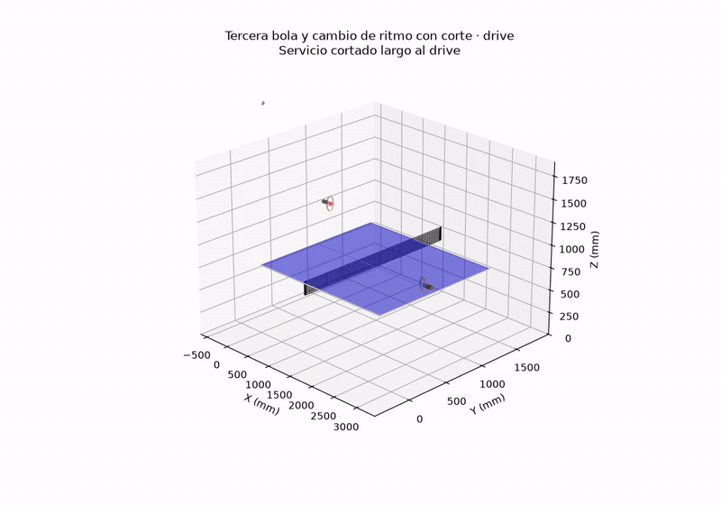

<div align="center">

# Table Tennis Physics Simulator
### From ball flight and racket contact to reproducible rally experiments

**Python · numerical simulation · parameter search · interactive notebooks**

[Get started](#quick-start) · [Benchmarks](#what-can-be-studied) · [Notebooks](notebooks/) · [Full technical reference](README_TECHNICAL.md)

</div>



## The question

How do initial velocity, spin, racket impact, and contact mechanics shape a **legal and repeatable** serve or rally? This project provides a numerical experiment platform—not a hardware-calibrated autonomous table-tennis robot.

## What can be studied?

| Area | Available tools |
| --- | --- |
| Flight & collisions | 3D trajectories with drag, Magnus force, RK4, table and racket contact models |
| Serve and return design | Parameter search, service families, presets, and legal-contact checks |
| Reproducibility | Fixed conditions, numerical validation, repeated benchmarks, and saved candidates |
| Visualization | Jupyter explorers, playable MP4 sequences, and locally generated HTML viewers |

The physics baseline draws on the *Ace* publication cited in the [technical reference](README_TECHNICAL.md). Where coefficients are not reported by the paper, the repository **keeps explicit legacy or Coulomb assumptions** instead of presenting them as experimentally identified.

## Quick start

Requires **Python 3.10+**. For Windows, the environment bootstrap also registers the Jupyter kernel:

```powershell
powershell -NoProfile -ExecutionPolicy Bypass -File .\scripts\setup_environment.ps1
.\.venv\Scripts\table-tennis.exe doctor
.\.venv\Scripts\table-tennis.exe simulate
.\.venv\Scripts\table-tennis.exe benchmark direct --repeat 1
```

[Installation and all CLI commands](README_TECHNICAL.md) · [Exploratory notebooks](notebooks/).

## A software-engineering detail that matters

The numerical core lives in [`src/table_tennis/physics.py`](src/table_tennis/physics.py), independently of notebooks and plotting. Automated tests check physical invariants, architecture boundaries and CLI behavior outside the repository, including [package structure](tests/test_package_structure.py) and [ACE flight/contact equations](tests/test_ace_physics.py).

Results, candidates, and videos are generated into `outputs/` without silently replacing versioned presets. Review the [benchmark modules](src/table_tennis/benchmarks/) and [validation tests](tests/) before extrapolating results.

## Evidence & limitations

- **Supported:** internal numerical checks, legal trajectory constraints, baseline comparison and reproducible videos.
- **Assumed:** model coefficients, contact regimes, and geometry as defined in code and documentation.
- **Not claimed:** experimentally calibrated robot/racket contact, robotic hardware control, or performance against live athletes.

**Further reading:** [Physics and derivations](README_TECHNICAL.md#ace-physical-model) · [Organization](README_TECHNICAL.md#organization) · [Verification](README_TECHNICAL.md#verification).
